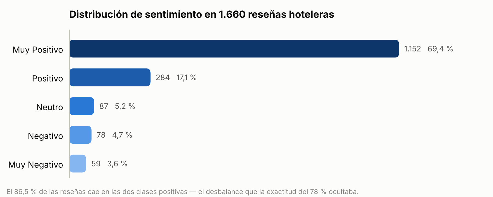

# Análisis de sentimientos en reseñas hoteleras del Suroeste Antioqueño

Clasificación automática del sentimiento de reseñas de hoteles en 12 municipios
del Suroeste de Antioquia, usando un modelo BERT multilingüe, con análisis
léxico y visualización interactiva de los resultados.



## Problema

Los municipios turísticos del Suroeste antioqueño reciben cientos de reseñas de
visitantes cada año, pero esa información queda dispersa en texto libre. La
calificación numérica que deja el usuario resume poco: no dice *qué* falló ni
*qué* funcionó, ni permite comparar la percepción entre municipios.

El objetivo fue convertir ese texto en datos estructurados que permitieran
responder tres preguntas: cómo se distribuye la percepción de los visitantes,
si existen diferencias entre municipios, y qué temas dominan las reseñas
negativas.

## Datos

- **Fuente:** reseñas públicas de alojamientos en TripAdvisor
- **Volumen:** 1.660 reseñas sobre alojamientos y 1.157 sobre hoteles
- **Cobertura:** 12 municipios — Jericó, Jardín, Andes, Fredonia, Támesis,
  Amagá, Ciudad Bolívar, La Pintada, Santa Bárbara, Urrao, Venecia y Caramanta
- **Campos:** título, cuerpo, idioma, calificación individual, calificación
  global del establecimiento, municipio y fecha
- **Estado inicial:** texto libre sin estructura, en varios idiomas, con
  longitudes muy dispares

> **Nota sobre privacidad:** el conjunto original incluía nombres de usuario y
> enlaces a perfiles. Esas columnas fueron eliminadas antes de publicar. El
> repositorio incluye únicamente una muestra anonimizada; el conjunto completo
> no se redistribuye.

 "Se eliminaron identificadores de autor y enlaces a contenido de terceros; se conservó el texto de las reseñas, los metadatos del establecimiento y las etiquetas de sentimiento generadas."

## Método

**1. Clasificación de sentimiento**

Se usó el modelo `nlptown/bert-base-multilingual-uncased-sentiment` de Hugging
Face, que asigna una puntuación de 1 a 5 estrellas. Se eligió un modelo
multilingüe porque las reseñas mezclan español e inglés, lo que descartaba tanto
los diccionarios de polaridad por idioma como los modelos monolingües.

Las puntuaciones se mapearon a cinco categorías: Muy Negativo, Negativo, Neutro,
Positivo y Muy Positivo.

**Manejo de longitud:** BERT tiene un límite de tokens por secuencia. Las
reseñas que lo superaban se truncaban al máximo permitido por el tokenizador,
evitando que el pipeline fallara con los textos largos.

Se analizaron por separado el **cuerpo** y el **título** de cada reseña, lo que
permite detectar casos donde ambos discrepan.

**2. Análisis léxico**

Con NLTK se tokenizaron las reseñas, se eliminaron *stopwords* en español y
signos de puntuación, y se calcularon las palabras y *n-gramas* más frecuentes
en cada clase de sentimiento.

**3. Modelado exploratorio**

Se ajustó una regresión logística multiclase usando variables *dummy* de
municipio como predictoras, para evaluar si la ubicación explica por sí sola la
percepción del visitante.

## Resultados

**La percepción general es muy positiva, pero fuertemente desbalanceada:**

| Sentimiento | Reseñas | % |
|---|---:|---:|
| Muy Positivo | 1.152 | 69,4 % |
| Positivo | 284 | 17,1 % |
| Neutro | 87 | 5,2 % |
| Negativo | 78 | 4,7 % |
| Muy Negativo | 59 | 3,6 % |

**Dos municipios concentran el turismo.** Jericó (677 reseñas) y Jardín (520)
suman el 72 % del total. Los demás municipios tienen volúmenes muy inferiores,
y en casos como Caramanta apenas una reseña, lo que impide sacar conclusiones
sobre ellos.

**Jericó destaca en proporción de reseñas muy positivas** (539 de 677, un 80 %)
frente a Jardín (318 de 520, un 61 %), que concentra más comentarios negativos
y neutros en términos relativos.

### El resultado más interesante: una precisión engañosa

La regresión logística alcanzó una **exactitud del 78 %**, cifra que a primera
vista parece buena. No lo es.

```
              precision    recall  f1-score   support
Muy Negativo       0.71      0.86      0.77        14
    Negativo       0.38      0.23      0.29        13
      Neutro       0.50      0.06      0.11        16
    Positivo       0.44      0.27      0.34        55
Muy Positivo       0.84      0.97      0.90       234

    accuracy                           0.78       332
   macro avg       0.57      0.48      0.48       332
```

El **F1 macro es 0,48**: menos de la mitad. La exactitud alta se explica porque
el 70 % de las reseñas pertenece a una sola clase, y el modelo acierta casi
siempre prediciendo esa. En la clase Neutro el *recall* es 0,06 — prácticamente
no la detecta.

**Conclusión:** el municipio por sí solo no explica el sentimiento de una
reseña. El modelo no encontró señal real; encontró la clase mayoritaria. Es
justamente el tipo de resultado que la exactitud oculta y las métricas por
clase revelan.

## Limitaciones

- **Desbalance de clases severo**, no corregido. Un tratamiento adecuado
  requeriría ponderación de clases, remuestreo o métricas de evaluación
  distintas desde el inicio.
- **La regresión logística no convergió** con los parámetros por defecto
  (`ConvergenceWarning` de lbfgs); habría que aumentar `max_iter` o escalar
  las variables.
- **Sesgo de autoselección:** quien deja reseña no representa a todos los
  visitantes. Las reseñas tienden a los extremos.
- **El modelo no fue evaluado contra etiquetas humanas**, así que se desconoce
  su precisión real sobre este dominio específico.
- **Muestra insuficiente en municipios pequeños** para conclusiones válidas.

## Qué haría distinto

- Validar el clasificador contra una muestra etiquetada manualmente.
- Tratar el desbalance desde el diseño, no solo reportarlo.
- Incorporar variables con señal real (precio, categoría del establecimiento,
  temporada) en lugar de solo el municipio.
- Complementar el análisis léxico con modelado de tópicos para identificar los
  temas de queja de forma sistemática.

## Stack

Python · pandas · Hugging Face Transformers · NLTK · scikit-learn · Plotly ·
Matplotlib · WordCloud

## Estructura

```
├── aplicacion4.ipynb        # notebook principal
├── data/
│   └── muestra_anonimizada.csv
├── imagenes/                # gráficos del README
└── requirements.txt
```

## Cómo ejecutarlo

```bash
git clone https://github.com/yeisongomezmejia/analisis-sentimientos-turismo-antioquia.git
cd analisis-sentimientos-turismo-antioquia
pip install -r requirements.txt
jupyter notebook aplicacion4.ipynb
```

La primera ejecución descarga el modelo de Hugging Face (~600 MB).

---

*Proyecto desarrollado en 2024 como primer trabajo de análisis de datos.*